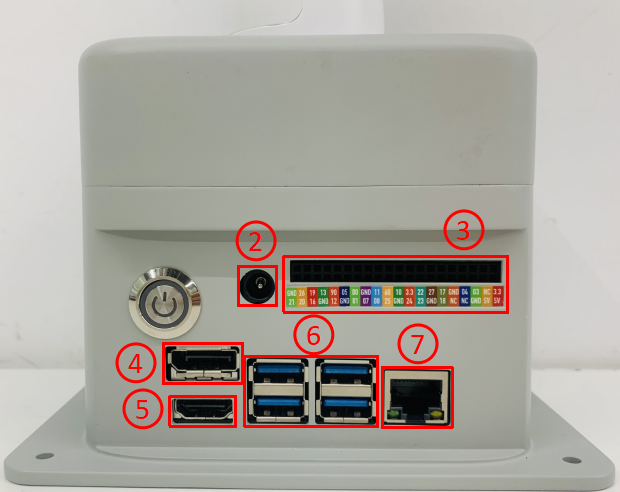
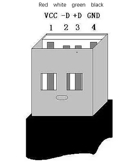
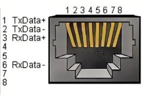
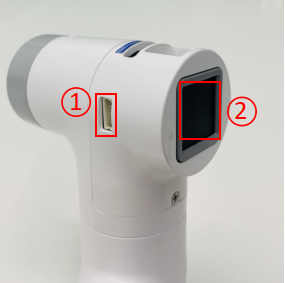

  

# 00 · Specifications — Hardware — 01 Overview

<!-- nav:auto -->

  <a href="../../README.md"><b>Home</b></a> &nbsp;|&nbsp;
  <a href="README.md"><b>&#8592; Back</b></a> &nbsp;|&nbsp;
  <a href="02_arm_parameters.md"><b>Forward &#8594;</b></a>

---

## 1. The parts

  
   The myCobot 280 with the adaptive gripper on the wrist.

| Part | What it is | Detail in |
| :--- | :--- | :--- |
| **Jetson Nano** | The base computer (Ubuntu, ROS, vision). | [03_jetson_nano.md](03_jetson_nano.md) |
| **Six servo motors** | One per joint (J1–J6). | [02_arm_parameters.md](02_arm_parameters.md) |
| **M5Stack Atom** | ESP32 board at the wrist. | [06_pinouts.md](06_pinouts.md) |
| **Adaptive gripper** | Two fingers, 20–45 mm, LEGO mount. | [04_gripper.md](04_gripper.md) |
| **USB camera v2.0** | Webcam on a LEGO bracket. | [05_camera.md](05_camera.md) |
| **E-stop (REVIEW)** | Stop button on the base header. | [09_buttons_and_e_stop.md](09_buttons_and_e_stop.md) |

---

## 2. Connections

  
   A PC connected to the robot over one serial link.

One shared cable through the arm carries every message. Each message carries the address of the device
it names, and that device answers.

| Talker | Listener | Over | Speed |
| :--- | :--- | :--- | :--- |
| A PC / laptop | The base (Jetson) | USB / Type-C | 115 200 baud |
| The Jetson | 6 servos + Atom | internal bus `/dev/ttyTHS1` | 1 000 000 baud |
| The Atom | Gripper, LED, wrist button | Grove port / pins | local |
| The camera | The Jetson | USB | USB 2.0 |

The message format is in [07_serial_protocol.md](07_serial_protocol.md).

---

## 3. Base interfaces (outside of the robot)

  
   Base interfaces: ① switch, ② DC power, ③ 40-pin group 1, ④ Display Port, ⑤ HDMI, ⑥ USB 3.0, USB 2.0, ⑦ Ethernet.

| # | Port | Detail |
| :---: | :--- | :--- |
| ① | **Switch** | Powers the whole machine on (white light) / off. |
| ② | **Power DC jack** | Main power. Barrel 6.5 mm outside / 2.0 mm inside. The supply as **12 V**; 5 A. Powers the Jetson and all servos. The Jetson power monitor reads ≈5.0 V on its inputs. |
| ③ | **Function Interface Group 1** | The 40-pin header. See [06_pinouts.md](06_pinouts.md). |
| ④ | **Display Port** | Monitor output. |
| ⑤ | **HDMI** | Monitor output. |
| ⑥ | **USB 3.0, USB 2.0** | USB ports. |
| ⑦ | **Ethernet (RJ45)** | Wired network port, not connected on this unit. The robot is online over the **Intel Wireless-AC** card and **Bluetooth 4.2**. |

  
  
   Left: USB ports. Right: the Ethernet port.

---

## 4. Inside the base

The enclosure contains the **Jetson Nano** sitting on top of a **green base board (PCBA)**. The fan,
the power indicator, the main power cable and the servo cable connect to this stack; the microSD card
that holds the operating system fits under the board.

  
  
   Left: the main control board inside the base. Right: the green base PCBA that sits above it.

| Inside the base | What it is |
| :--- | :--- |
| **Jetson Nano board** | The base computer. The microSD card is under it. |
| **Green base PCBA** | Carries the external connectors and the servo/motor connector. |
| **Servo cable** | The black / red / white 3-pin cable that feeds the six motors. |
| **Fan and power indicator** | Cooling and the status light on the front of the base. |
| **Main power cable** | The black and red wires from the DC jack. |

The teardown sequence (cover, servo cable, fan and power cables, then the boards) and the image
write steps are in [11_maintenance.md §6](11_maintenance.md#6-replace-the-tf-card).

---

## 5. Wrist interfaces (at the end of the arm)

  
  
   Left: ① servo interface, ② Atom. Right: ① group 2, ② Grove port, ③ Type-C.

  
   The Grove port: GND / 5V / G26 / G32.

| Interface | Pins | Used for |
| :--- | :--- | :--- |
| **Grove port** | GND, 5V, G26, G32 | The adaptive gripper. |
| **Function Interface Group 2** | 5V, GND, 3V3, G22, G19, G23, G33 | Wrist IO. |
| **Type-C** | — | Flashing/testing the Atom. |

---

## 6. Atom (wrist board)

- **Gripper** open/close, through the Grove port.
- **5×5 RGB LED matrix** on **GPIO 27**.
- **User button** on **GPIO 39**.
- **Auxiliary pins** on Group 2.

<!-- nav:auto -->

  <a href="#top"><b>Top</b></a>

