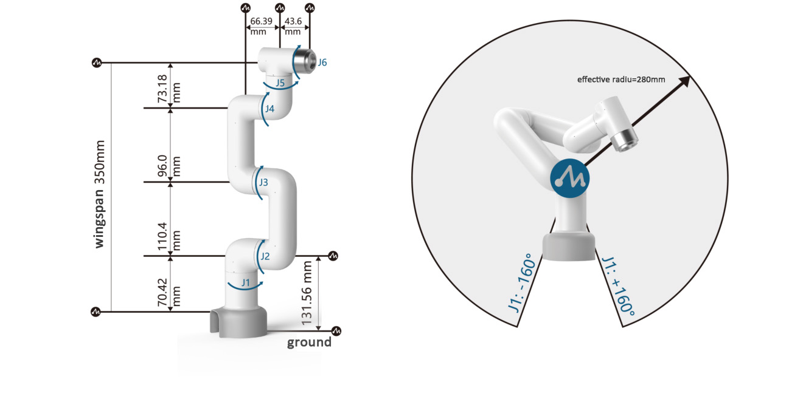
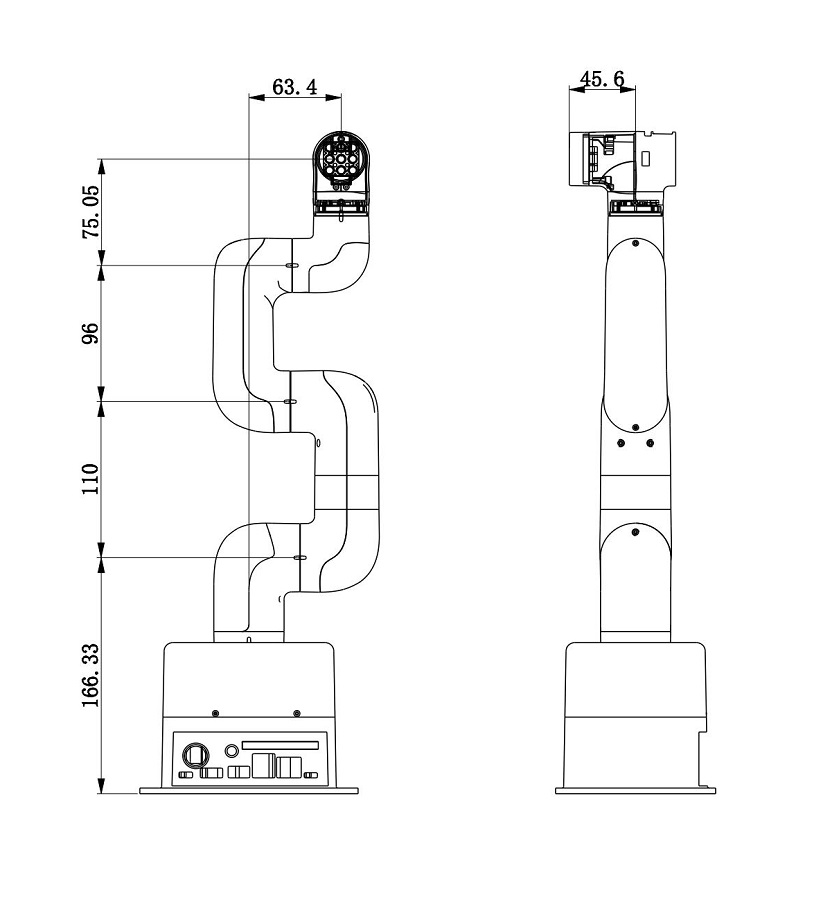
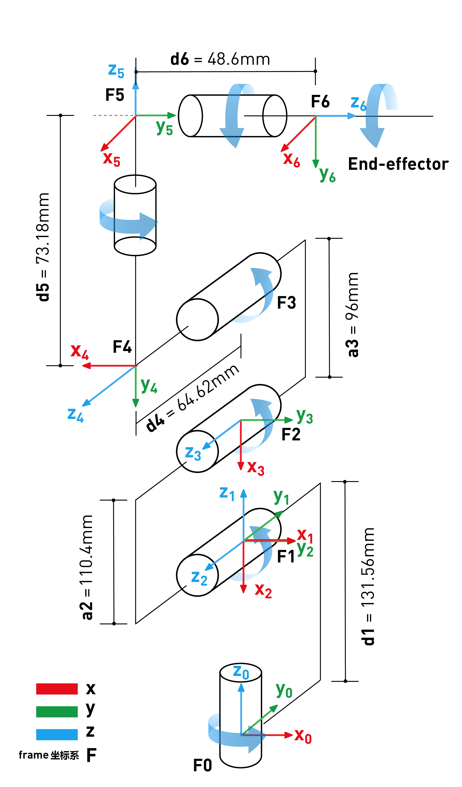
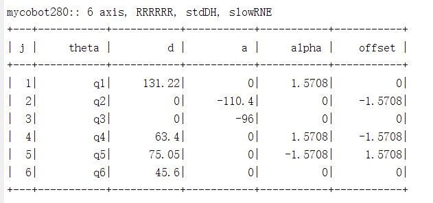
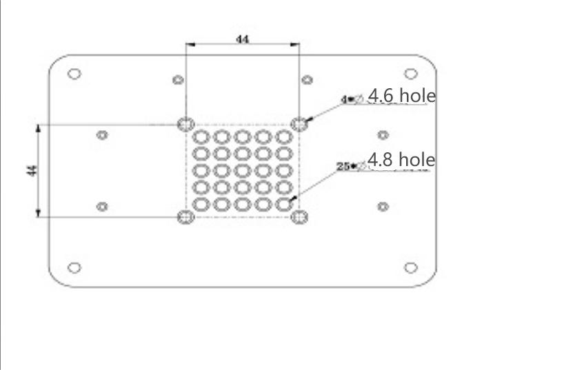

  

# 00 · Specifications — Hardware — 02 Arm parameters

<!-- nav:auto -->

  <a href="../../README.md"><b>Home</b></a> &nbsp;|&nbsp;
  <a href="01_overview.md"><b>&#8592; Back</b></a> &nbsp;|&nbsp;
  <a href="03_jetson_nano.md"><b>Forward &#8594;</b></a>

  
   The tip's reach: a 280 mm-radius sphere around the base.

---

## 1. General specifications

| Parameter | Value |
| :--- | :--- |
| Product name | Little Elephant Collaborative Robot Arm |
| Model | myCobot 280 for Jetson Nano |
| Degrees of freedom | 6 |
| Payload | 250 g |
| Working radius | 280 mm |
| Repeatability | ±0.5 mm |
| Weight | 1030 g |
| Power input | DC 8–12 V (port rated 8.4–14 V) |
| DC connector | barrel, OD 6.5 mm / ID 2.0 mm |
| Supplied adapter | 12 V @ 5 A |
| Jetson power rails (measured) | 5.0 V on the Jetson's INA3221 inputs |
| Operating temperature | −5 °C to +45 °C |
| Internal bus | UART `/dev/ttyTHS1` @ 1,000,000 baud |
| Gripper weight | 110 g fitted, leaving about 140 g net payload |

---

## 2. Shape and space

### 2.1 Workspace

The tip reaches inside a 280 mm-radius sphere around the base centre.

### 2.2 Structural dimensions

  
   Structural drawing from the brochure — CAD dimensions.

| Dimension | Value | URDF joint / axis |
| :--- | :--- | :--- |
| Base height (J1 → J2) | 157.56 mm | `joint2_to_joint1`, `z` |
| Link 2 (shoulder → elbow, J3 → J4) | 110.40 mm | `joint4_to_joint3`, `x` |
| Link 3 (elbow → wrist 1, J4 → J5) | 96.00 mm | `joint5_to_joint4`, `x` |
| Wrist offset (link 4, J4 → J5, vertical) | 64.62 mm | `joint5_to_joint4`, `z` |
| Wrist offset (link 5, J5 → J6) | 73.18 mm | `joint6_to_joint5`, `y` |
| Flange / tool offset (J6 → flange) | 45.60 mm | `joint6output_to_joint6`, `y` |
| Base footprint (G-base) | 150 × 110 × 32 mm | `g_base` |

---

## 3. Joint limits

| Joint | Name | Range (degrees) | Range (radians) |
| :---: | :--- | :---: | :---: |
| **J1** | Base | ±168° | −2.9321 … +2.9321 |
| **J2** | Shoulder | ±140° | −2.4434 … +2.4434 |
| **J3** | Elbow | ±150° | −2.6179 … +2.6179 |
| **J4** | Wrist 1 | ±150° | −2.6179 … +2.6179 |
| **J5** | Wrist 2 | −155° … +160° | −2.7052 … +2.7925 |
| **J6** | Flange | ±180° | −3.1416 … +3.1416 |

Speed and acceleration limit for every joint: **150 °/s** and **200 °/s²**.

---

## 4. Cartesian limits (X-Y-Z)

| Axis | Minimum | Maximum | Max speed | Max acceleration |
| :---: | :---: | :---: | :---: | :---: |
| **X** | −281.45 mm | +281.45 mm | 100 mm/s | 400 mm/s² |
| **Y** | −281.45 mm | +281.45 mm | 100 mm/s | 400 mm/s² |
| **Z** | −70.00 mm | +412.76 mm | 100 mm/s | 400 mm/s² |
| **Rx** | −180.0° | +180.0° | 40 °/s | 66 °/s² |
| **Ry** | −180.0° | +180.0° | 40 °/s | 66 °/s² |
| **Rz** | −180.0° | +180.0° | 40 °/s | 66 °/s² |

X/Y/Z is the tip position; Rx/Ry/Rz is the tip orientation.

---

## 5. DH / SDH parameters

Per joint: `θ` is the joint rotation; `d` is the offset along the joint axis; `a` is the offset along
the next link; `α` is the twist to the next axis; `offset` is a fixed calibration angle.

  
  
   Left: the frame diagram. Right: the published SDH table.

Official SDH model:

| Joint | `θ` | `d` (mm) | `a` (mm) | `α` | offset |
| :---: | :---: | :---: | :---: | :---: | :---: |
| 1 | q₁ | **131.22** | 0 | +90° | 0° |
| 2 | q₂ | 0 | **−110.40** | 0° | −90° |
| 3 | q₃ | 0 | **−96.00** | 0° | 0° |
| 4 | q₄ | **63.40** | 0 | +90° | −90° |
| 5 | q₅ | **75.05** | 0 | −90° | +90° |
| 6 | q₆ | **45.60** | 0 | 0° | 0° |

The SDH table is the published kinematic model. The lengths in section 2.2 come from the project's
URDF; both describe the same arm, with `d₁` measured differently (SDH 131.22 mm vs CAD 157.56 mm).

---

## 6. Mounting and tool attachment

### 6.1 The base

The bottom fits LEGO Technic and M4 screws.

  
   The base flange: LEGO grid and M4 holes.

### 6.2 The tool flange at Joint 6

The tip has LEGO Technic holes and threaded holes.

<!-- nav:auto -->

  <a href="#top"><b>Top</b></a>

