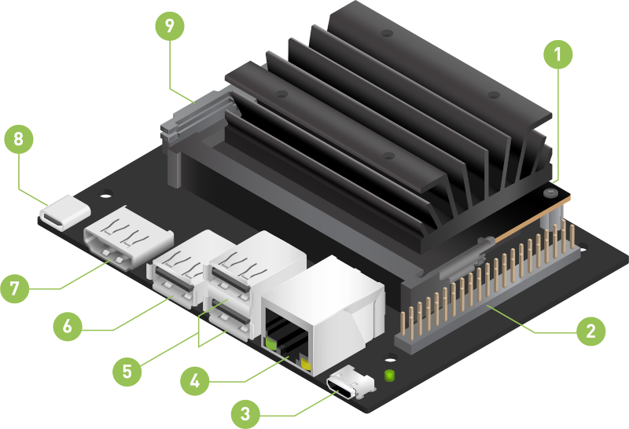

  

# 00 · Specifications — Hardware — 03 Jetson Nano

<!-- nav:auto -->

  <a href="../../README.md"><b>Home</b></a> &nbsp;|&nbsp;
  <a href="02_arm_parameters.md"><b>&#8592; Back</b></a> &nbsp;|&nbsp;
  <a href="04_gripper.md"><b>Forward &#8594;</b></a>

## 1. Board identity

  
   The NVIDIA Jetson Nano board in the base (labelled view).

| Item | Value |
| :--- | :--- |
| Model | NVIDIA Jetson Nano Developer Kit (`/proc/device-tree/model`) |
| SoC (device tree) | `nvidia,tegra210` — NVIDIA Tegra X1 (T210), 128-core Maxwell GPU |
| Module / carrier | module P3448-0002, carrier P3449-0000 B00 |
| Module serial | `1424023000355` |
| Hostname / user | `nano` / `er` |
| Position | Inside the base, on top of the base PCBA ([01](01_overview.md#4-inside-the-base)) |

The parameter table calls the SoC a *Broadcom BCM2711*; the board reports Tegra X1 (T210).

---

## 2. System and architecture

| Item | Value |
| :--- | :--- |
| Operating system | Ubuntu 20.04.6 LTS (Focal) |
| Kernel / architecture | Linux 4.9.253-tegra, aarch64 |
| JetPack | L4T R32.6.1 (JetPack 4.6.1) |
| CUDA | 10.2 |
| Power mode | MAXN (mode 0) |
| GPU clock | 76.8 – 921.6 MHz |
| Idle temperature | CPU 27 °C, GPU 25.5 °C, PMIC 50 °C, AO 33.5 °C (measured) |
| Monitoring | `jtop` runs as a service |

---

## 3. Robotics software (ROS)

| Item | Value |
| :--- | :--- |
| ROS 2 | Galactic, installed natively (not used by this project) |
| ROS 1 | Noetic, installed natively (not used by this project) |
| ROS environment | Not loaded by default |
| Python | 3.8.10 |
| pymycobot | 4.0.4b5 (class `MyCobot280`) |

The project runs **ROS 2 Jazzy inside Docker** (see [07_docker.md](../software/07_docker.md)). Native ROS installations are not used. `pymycobot` is used as reference (C++ serial protocol implementation follows its behavior). |

---

## 4. Compute, memory and storage

| Item | Value |
| :--- | :--- |
| CPU | 4 cores, Cortex-A57 (r1p1), 102–1479 MHz |
| CPU clock | runs at 1479 MHz under MAXN |
| RAM | 4 GB (3.9 GiB usable) |
| RAM in use | about 1.1 GiB used, about 2.6 GiB available |
| Swap | 4 × zram, about 1.9 GiB |
| Root filesystem | `/dev/mmcblk1p1` — 64 GB microSD (59 G, 24 G free) |
| eMMC | `/dev/mmcblk0` — 16 GB, fitted but not mounted |

The root filesystem microSD (TF) card is inside the base; replacement and re-imaging are in
[11_maintenance.md §6](11_maintenance.md#6-replace-the-tf-card).

---

## 5. Devices and peripherals

| Item | Value |
| :--- | :--- |
| Arm serial ports | `/dev/ttyTHS1` (UART `70006040`), `/dev/ttyTHS2`; no `/dev/ttyUSB*` or `/dev/ttyACM*` |
| Serial permissions | `/dev/ttyTHS1` is world read/write; `/dev/ttyTHS2` needs the `dialout` group; user `er` is in `dialout`. Baud: **1,000,000**. |
| Camera | `/dev/video0` — Realtek `0bda:5a63`, card "USB 2.0 Camera", serial `20220523`, USB 2.0 UVC |
| Camera media nodes | `/dev/media1` (camera), `/dev/media0` (Tegra VI) |
| Camera formats | MJPG 30 fps up to 2592×1944; YUYV 3 fps up to 2592×1944. **MJPG preferred.** |
| USB | Intel Bluetooth `8087:0a2b`, Dell mouse `413c:301a`, Cherry keyboard `046a:0111`, Realtek camera `0bda:5a63`, VIA hubs `2109:0817` / `2109:2817` |
| Audio | capture: tegra-snd-t210ref-mobile-rt565x (ADMAIF1–10) and the camera's USB audio; playback: tegra-hda (HDMI) and tegra-snd |
| I2C | 9 buses (`i2c-0` … `i2c-8`); bus 2 answers at `0x50` and `0x57`; buses 0 and 1 empty |
| SPI | none (`/dev/spidev*` absent) |
| GPIO | `gpiochip0` (tegra-gpio, 0–255), `gpiochip1` (max77620) |

---

## 6. Networking and access

| Item | Value |
| :--- | :--- |
| Wi-Fi | Intel Wireless-AC 8265 (`iwlwifi`, PCIe `8086:24fd`), channel 36 (5.18 GHz) |
| Wi-Fi network | ESSID `SEAME`, −45 dBm, 400 Mb/s, Tx 22 dBm |
| Wi-Fi power saving | on |
| Wi-Fi MAC | `58:a0:23:eb:34:2b` |
| Bluetooth | Intel Bluetooth 4.2 (`hci0`, USB `8087:0a2b`, address `58:A0:23:EB:34:2F`) |
| Ethernet | Realtek RTL8111/8168/8411 (`r8168`, PCIe `10ec:8168`), down |
| Network (Wi-Fi) | `wlan0`, subnet `10.20.118.0/16` (DHCP) |
| Open ports | SSH 22, VNC 5900, rpcbind 111 (CUPS 631, gpsd 2947 and DNS 53 on localhost only) |

---

## 7. Build and container tools

| Item | Value |
| :--- | :--- |
| C / C++ | gcc 8.4.0, CMake 3.16.3 |
| Docker | 24.0.7 (no docker compose plugin; use `docker run` as per Makefile) |
| Docker Compose | missing |

<!-- nav:auto -->

  <a href="#top"><b>Top</b></a>

