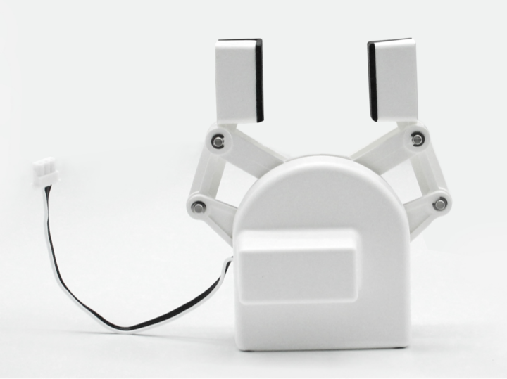
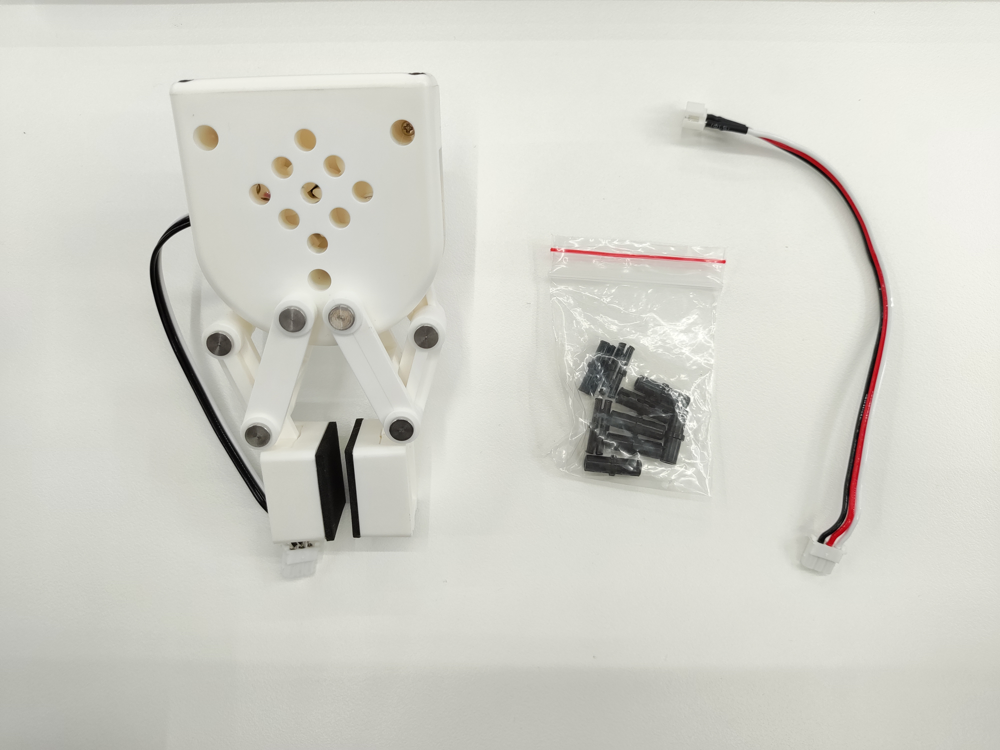
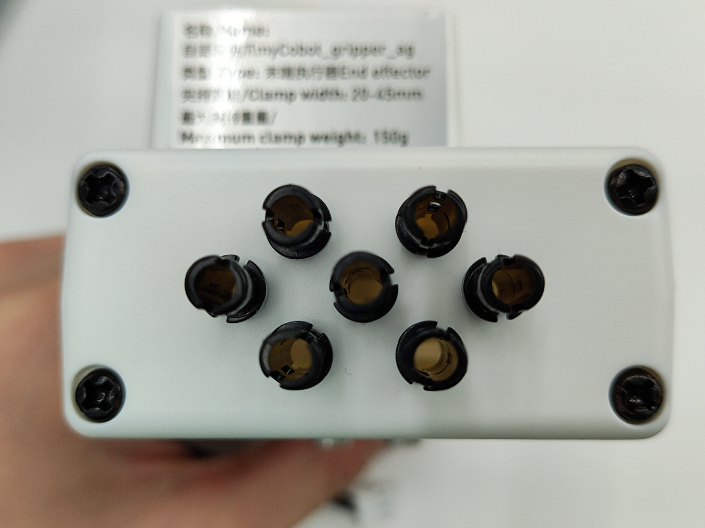
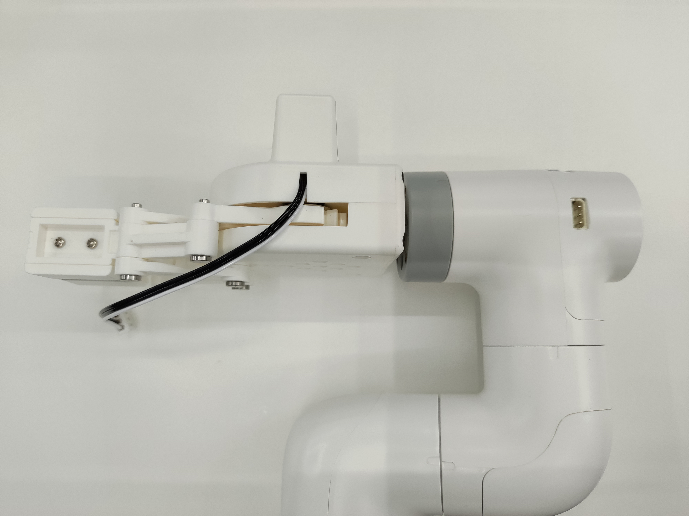
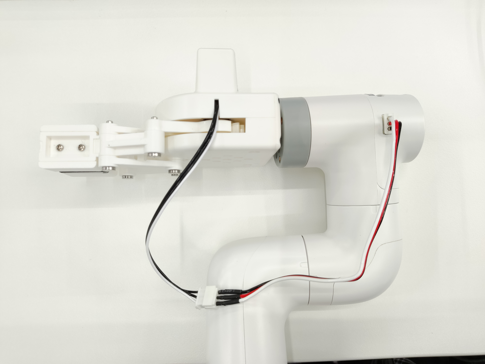
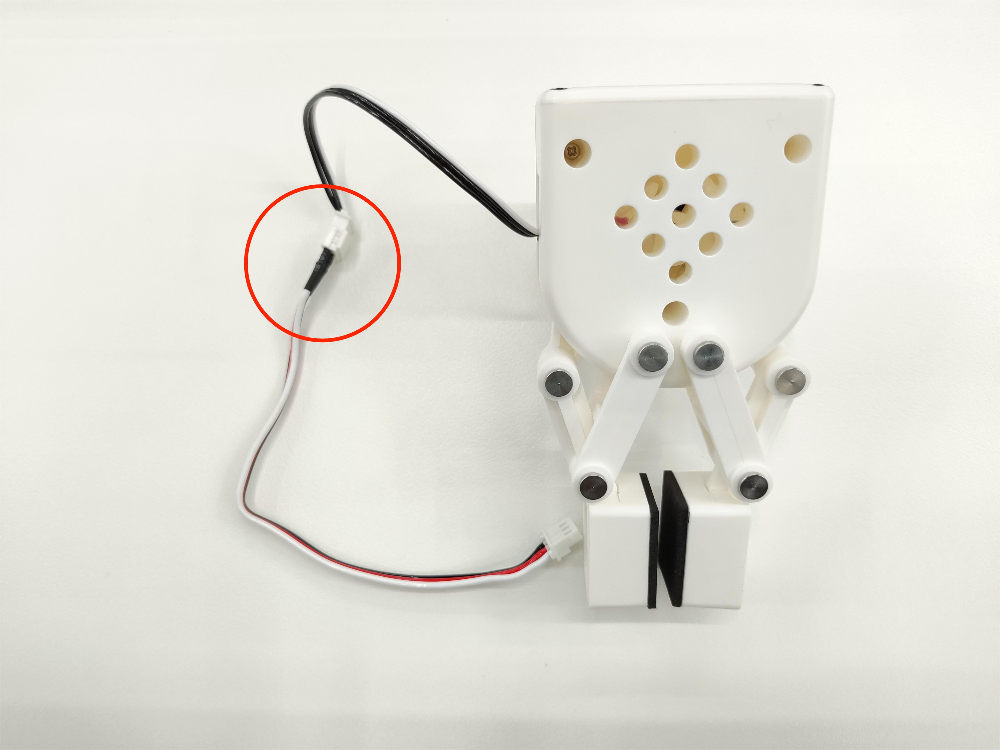
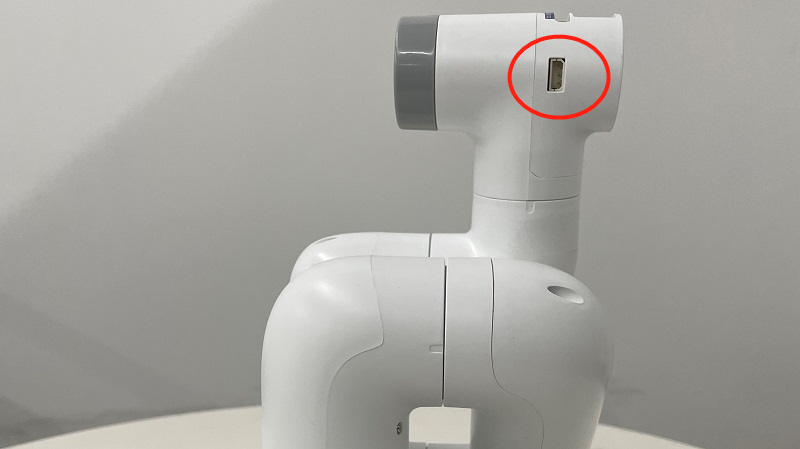
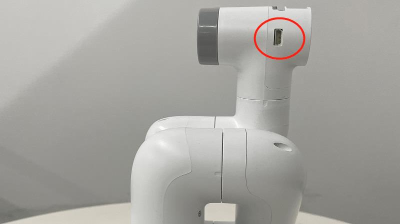
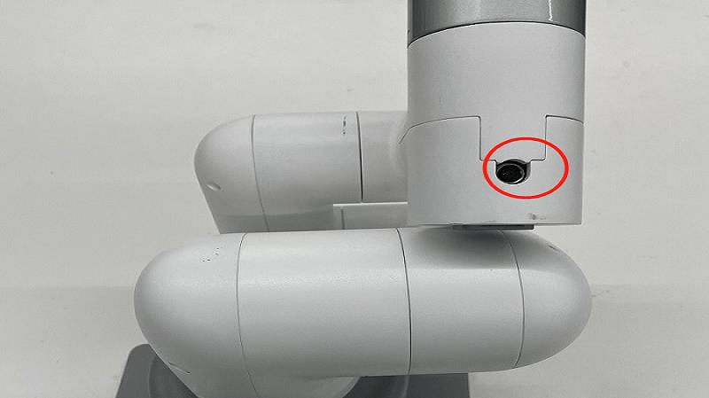

  

# 00 · Specifications — Hardware — 04 Gripper

<!-- nav:auto -->

  <a href="../../README.md"><b>Home</b></a> &nbsp;|&nbsp;
  <a href="03_jetson_nano.md"><b>&#8592; Back</b></a> &nbsp;|&nbsp;
  <a href="05_camera.md"><b>Forward &#8594;</b></a>

  
   The `myCobot_gripperAg_white` adaptive gripper.

The gripper is the `myCobot_gripperAg_white`: two plastic fingers driven by an electric motor. It
connects to the wrist with LEGO pins and to the Atom through the Grove port. Both fingers move in a
straight line, so the opening accepts a range of shapes.

---

## 1. Specification

| Parameter | Value |
| :--- | :--- |
| Name | mycobot280 Adaptive Gripper |
| Model | `myCobot_gripperAg_white` (white ABS) |
| Gripping range | 20–45 mm |
| Max gripping force | 150 g |
| Repeatability | 1.0 mm |
| Service life | one year |
| Drive | electric motor |
| Transmission | gear + connecting rod |
| Size | 112 × 94 × 50 mm |
| Weight | 110 g |
| Net payload | about 140 g |
| Mounting | LEGO Technic connector |
| Control | serial, through the Atom ([07](07_serial_protocol.md)) |
| Firmware | not returned by pymycobot 4.0.4b5 (`get_gripper_firmware_version` absent); read it in myStudio |

---

## 2. Operation

A motor turns a gear; the gear pushes a connecting rod that slides the fingers in and out. The
electronics control the speed and acceleration. One wire is a feedback line that reports the opening.

---

## 3. Package contents

  
   The gripper body with a short cable, LEGO pins, and a cable extension.

---

## 4. Fitting

**Mechanical**

1. Push the LEGO pin into the socket on the gripper base (longitudinally or transversely).

   
 1 · Insert the LEGO connector pin.

2. Line it up with the flange at the end of the arm and press it on (or fit the pin to the flange
   first, then the gripper).

   

     
     
      2 · Mount on the flange.
   

**Electrical**

1. Connect the extension cable to the gripper motor terminal.

   
 1 · Connect the motor cable.

2. Plug the 4-wire Grove connector into the Atom's Grove port.

   
 2 · Plug into the Atom's Grove port.

Gripper header and top interface:

  
  
   Left: the gripper pins at the Atom. Right: the top interface.

---

## 5. Control commands

The gripper is driven by messages sent to the Atom over the serial bus.

| Command | Value |
| :--- | :--- |
| Read opening | Returns the opening as a percentage. |
| Open / close | Opens or closes fully at a chosen speed. |
| Go to position | Moves to any opening from 0 % (closed) to 100 % (about 45 mm). |
| Zero | Sets the current position as zero. |
| Read state | Returns whether a move is in progress. |

Speed is 1 to 100. 0 % is fully closed, 100 % is fully open. The byte-level format is in
[07_serial_protocol.md](07_serial_protocol.md).

<!-- nav:auto -->

  <a href="#top"><b>Top</b></a>

