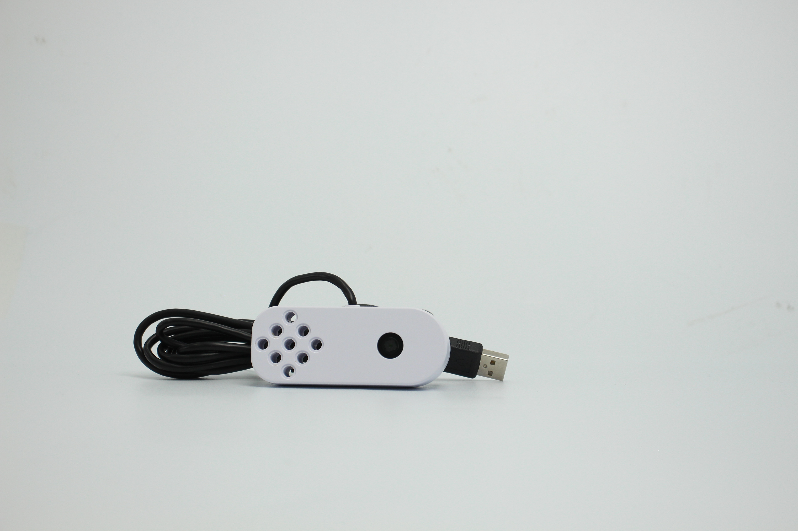
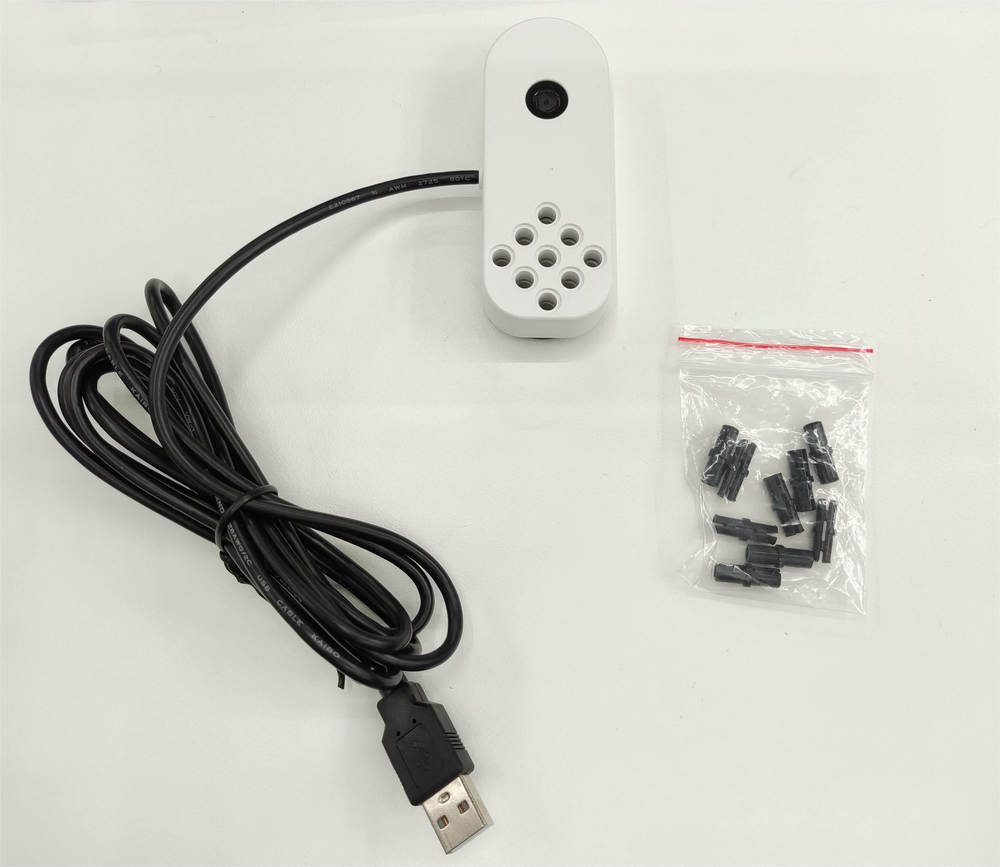
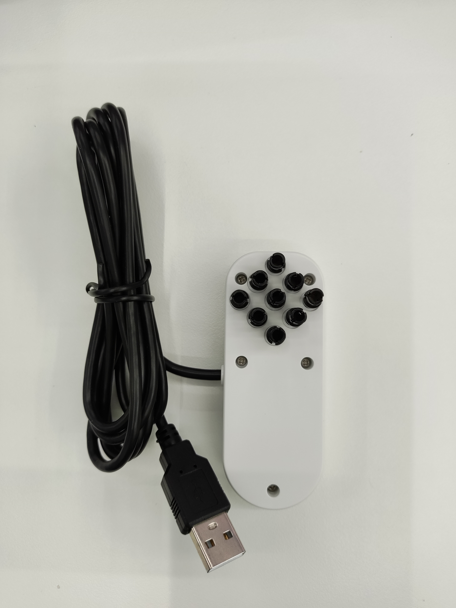
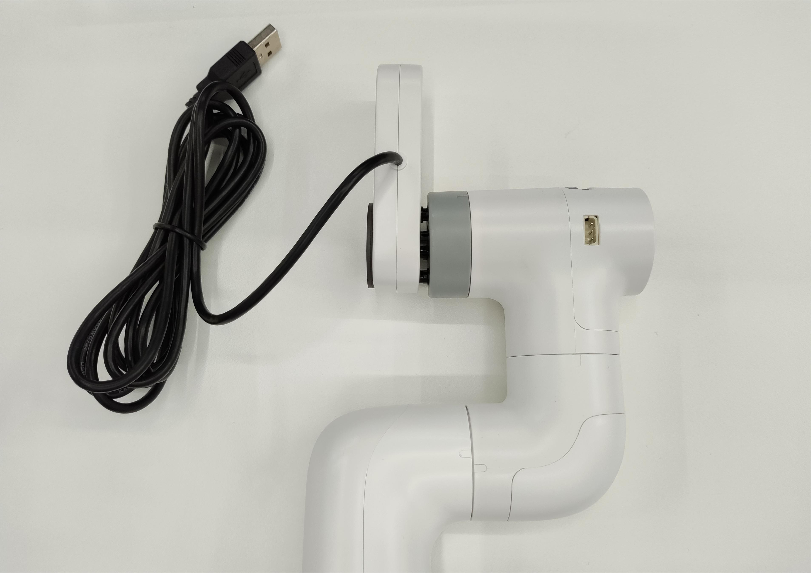

  

# 00 · Specifications — Hardware — 05 Camera

<!-- nav:auto -->

  <a href="../../README.md"><b>Home</b></a> &nbsp;|&nbsp;
  <a href="04_gripper.md"><b>&#8592; Back</b></a> &nbsp;|&nbsp;
  <a href="06_pinouts.md"><b>Forward &#8594;</b></a>

  
   The myCobot camera module v2.0.

The camera is the myCobot camera module v2.0 (`myCobot_cameraHolder_J6`): a USB 2.0 webcam on a LEGO
bracket. It mounts on the wrist (eye-in-hand) or on a fixed bracket.

---

## 1. Specification

| Item | Value |
| :--- | :--- |
| Model | myCobot camera module v2.0 (`myCobot_cameraHolder_J6`) |
| Interface | USB 2.0 High / Full Speed (Type-A into the base) |
| Lens | 1.7 mm focal length |
| Field of view | about 60° |
| Body | ABS, white, 83 × 64 × 16 mm |
| Mounting | LEGO connector |
| Lifespan | two years |

---

## 2. Device on the unit

| Item | Value |
| :--- | :--- |
| Video device | Realtek `0bda:5a63`, USB 2.0 UVC at `/dev/video0`; card "USB 2.0 Camera", serial `20220523` |
| Media node | `/dev/media1` (camera), `/dev/media0` (Tegra VI) |
| Audio | built-in microphone (USB audio interface) |
| MJPG | 30 fps up to 2592×1944 (**preferred**) |
| YUYV | 3 fps up to 2592×1944 |

---

## 3. Package contents

  
   The camera module and its cable.

---

## 4. Fitting

**Mechanical**

1. Slot the LEGO connector of the `myCobot_cameraHolder_J6` bracket onto the tool flange at J6
   (eye-in-hand), or onto the fixed bracket.
2. Press it on until the pin seats.

**Electrical**

1. Route the camera's USB cable along the arm, clear of the joints.
2. Plug the Type-A connector into a USB port on the base.

  
  
   Left: the LEGO mount. Right: mounted on the arm's flange.

<!-- nav:auto -->

  <a href="#top"><b>Top</b></a>

