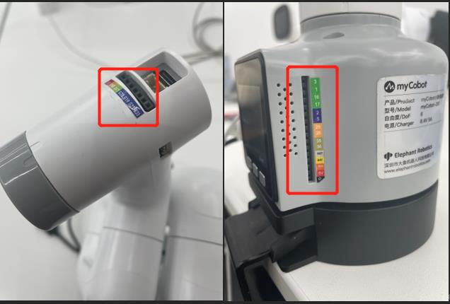
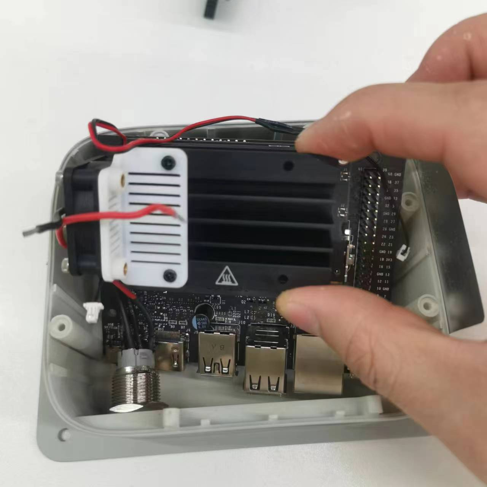
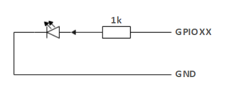
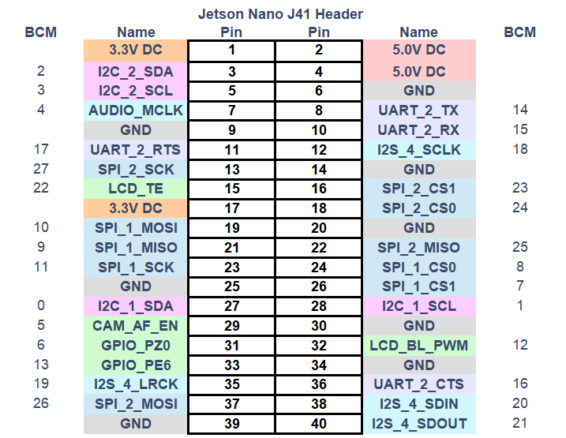
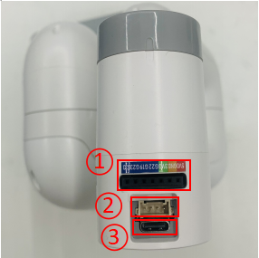
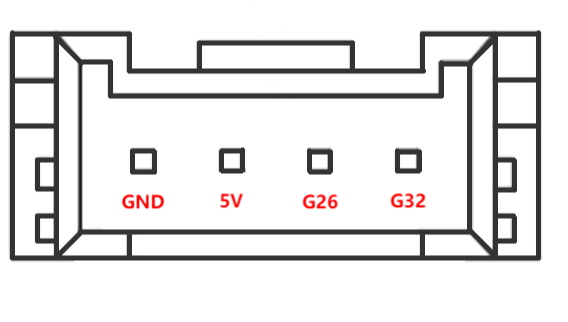

  

# 00 · Specifications — Hardware — 06 Pinouts

<!-- nav:auto -->

  <a href="../../README.md"><b>Home</b></a> &nbsp;|&nbsp;
  <a href="05_camera.md"><b>&#8592; Back</b></a> &nbsp;|&nbsp;
  <a href="07_serial_protocol.md"><b>Forward &#8594;</b></a>

The base 40-pin header, the wrist (Atom) ports, and the electrical limits.

  
   The silkscreen on the base, showing how the header pins are labelled.

The header itself is on the **Jetson board inside the base**; the base PCBA below it carries the servo
and power connectors. The base interior is described in
[01_overview.md](01_overview.md#4-inside-the-base).

  
   The Jetson board inside the base; the 40-pin header sits on it.

---

## 1. The base 40-pin header (Function Interface Group 1)

### 1.1 Pin numbering

The numbering follows the board's position inside the enclosure:

- **Pin 1 and pin 2 are at the FAR RIGHT.**
- Count **right to left** along the top and bottom rows.
- The sticker uses **BCM** naming. The 40-pin header reads **right-to-left** (pin 1 far right). |

**Top row (odd pins), read from the right edge going left:**

| Pin | 1 | 3 | 5 | 7 | 9 | 11 | 13 | 15 | 17 | 19 | 21 | 23 | 25 | 27 | 29 | 31 | 33 | 35 | 37 | 39 |
| :--- | :-: | :-: | :-: | :-: | :-: | :-: | :-: | :-: | :-: | :-: | :-: | :-: | :-: | :-: | :-: | :-: | :-: | :-: | :-: | :-: |
| Label | 3.3 | NC | 03 | 04 | GND | 17 | 27 | 22 | 3.3 | 10 | 09 | 11 | GND | 00 | 05 | 06 | 13 | 19 | 26 | GND |

**Bottom row (even pins), read from the right edge going left:**

| Pin | 2 | 4 | 6 | 8 | 10 | 12 | 14 | 16 | 18 | 20 | 22 | 24 | 26 | 28 | 30 | 32 | 34 | 36 | 38 | 40 |
| :--- | :-: | :-: | :-: | :-: | :-: | :-: | :-: | :-: | :-: | :-: | :-: | :-: | :-: | :-: | :-: | :-: | :-: | :-: | :-: | :-: |
| Label | 5V | 5V | GND | NC | NC | 18 | GND | 23 | 24 | GND | 25 | 08 | 07 | 01 | GND | 12 | GND | 16 | 20 | 21 |

### 1.2 Full pin map

| Pin | Label | Signal / function | Notes |
| :---: | :---: | :--- | :--- |
| **1** | **3.3** | 3.3 V power | **Power only.** Share max 1.5 A with pin 17. |
| **2** | **5V** | 5 V power | **Power only.** Share max 2.5 A with pin 4. |
| **3** | **NC** | I2C data (GPIO 02) | **Occupied.** Reserved inside; has a fixed pull-up. |
| **4** | **5V** | 5 V power | **Power only.** |
| **5** | **03** | I2C clock (GPIO 03) | **Occupied.** Reserved inside; has a fixed pull-up. |
| **6** | **GND** | Ground | 0 V. |
| **7** | **04** | AUD_MCLK (GPIO 04) | Free GPIO. |
| **8** | **NC** | UART TX (GPIO 14) | **Occupied.** Internal serial TX to the servos — off the header. |
| **9** | **GND** | Ground | 0 V. |
| **10** | **NC** | UART RX (GPIO 15) | **Occupied.** Internal serial RX from the servos — off the header. |
| **11** | **17** | GPIO 17 | PAD occupied inside. |
| **12** | **18** | GPIO 18 | PAD occupied inside. |
| **13** | **27** | SPI1_SCK (GPIO 27) | Free GPIO. |
| **14** | **GND** | Ground | 0 V. |
| **15** | **22** | GPIO 22 | Free GPIO. |
| **16** | **23** | SPI1_CS1 (GPIO 23) | Free GPIO. |
| **17** | **3.3** | 3.3 V power | **Power only.** |
| **18** | **24** | SPI1_CS0 (GPIO 24) | Free GPIO. |
| **19** | **10** | SPI0_MOSI (GPIO 10) | Free GPIO. |
| **20** | **GND** | Ground | 0 V. |
| **21** | **09** | SPI0_MISO (GPIO 09) | Free GPIO. |
| **22** | **25** | SPI1_MISO (GPIO 25) | Free GPIO. |
| **23** | **11** | SPI0_SCK (GPIO 11) | Free GPIO. |
| **24** | **08** | SPI0_CS0 (GPIO 08) | Free GPIO. |
| **25** | **GND** | Ground | 0 V. |
| **26** | **07** | SPI0_CS1 (GPIO 07) | Free GPIO. |
| **27** | **00** | ID EEPROM data (GPIO 00) | **Occupied.** Module ID EEPROM. |
| **28** | **01** | ID EEPROM clock (GPIO 01) | **Occupied.** Module ID EEPROM. |
| **29** | **05** | GPIO 05 | Free GPIO. |
| **30** | **GND** | Ground | 0 V. |
| **31** | **06** | GPIO 06 | Free GPIO. |
| **32** | **12** | GPIO 12 | PWM capable. |
| **33** | **13** | GPIO 13 | PWM capable. |
| **34** | **GND** | Ground | 0 V. |
| **35** | **19** | I2S_4_LRCK (GPIO 19) | Free GPIO. |
| **36** | **16** | GPIO 16 | Free GPIO. |
| **37** | **26** | SPI1_MOSI (GPIO 26) | Free GPIO. |
| **38** | **20** | I2S_4_SDIN (GPIO 20) | Free GPIO. |
| **39** | **GND** | Ground | 0 V. |
| **40** | **21** | I2S_4_SDOUT (GPIO 21) | Free GPIO. |

> **Occupied pins: 3, 8, 10, 27 and 28.** Pins 8 and 10 carry the internal servo serial link (moved
> off the header); pin 3 is reserved; pins 27/28 are the module-ID EEPROM. UART2 and I2C2 are used internally.

The internal links are `/dev/ttyTHS1` (UART `70006040`) and `/dev/ttyTHS2`; I2C buses `0`–`8` exist
(bus 2 answers at `0x50` and `0x57`, buses 0 and 1 are empty); no `/dev/spidev*` device is present. |

---

## 2. Electrical limits

- **Logic is 3.3 V.** A HIGH output is 3.3 V. 5 V on a GPIO damages the Jetson.
- **Current.** A pin can pull about **40 mA**, dropping to about **29 mA** as more pins are used at
  once.
- Pins are for signals. Motors and lamps require a transistor or relay.
- The 5 V and 3.3 V pins are not signal pins.

**GPIO output example** (an LED switched by a pin):

  
   Driving an LED from a GPIO pin.

**Pin multiplexing.** Enabling I2C, SPI or UART on a pin removes its GPIO role:

  
   Which alternate functions each pin can take.

---

## 3. The wrist (Atom) ports

  
   Wrist ports: ① Function Interface Group 2, ② Grove port, ③ Type-C.

### 3.1 Grove port

  

| Pin | Wire | Signal | ESP32 GPIO | Purpose |
| :---: | :---: | :---: | :---: | :--- |
| 1 | Black | `GND` | GND | Ground |
| 2 | Red | `5V` | 5V | Power |
| 3 | Yellow | `G26` | GPIO 26 | Command (PWM) |
| 4 | White | `G32` | GPIO 32 | Feedback |

### 3.2 Function Interface Group 2 (2.54 mm header)

| Label | Type | Purpose |
| :---: | :---: | :--- |
| **5V** | Power | 5 V out |
| **GND** | Power | Ground |
| **3V3** | Power | 3.3 V out |
| **G22** | I/O | GPIO 22 |
| **G19** | I/O | GPIO 19 |
| **G23** | I/O | GPIO 23 |
| **G33** | I/O | GPIO 33 |

### 3.3 On-board Atom features

- **5×5 RGB LED matrix** → ESP32 **GPIO 27**.
- **Tactile button** → ESP32 **GPIO 39** (read over the serial bus, [07](07_serial_protocol.md)).

<!-- nav:auto -->

  <a href="#top"><b>Top</b></a>

