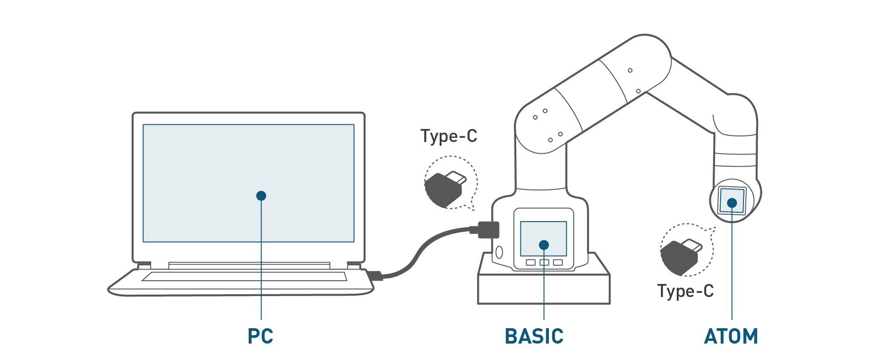

  

# 00 · Specifications — Hardware — 07 Serial protocol

<!-- nav:auto -->

  <a href="../../README.md"><b>Home</b></a> &nbsp;|&nbsp;
  <a href="06_pinouts.md"><b>&#8592; Back</b></a> &nbsp;|&nbsp;
  <a href="08_command_reference.md"><b>Forward &#8594;</b></a>

  
   A PC talking to the robot through one serial link.

The Jetson sends short messages down a serial cable; each servo or board reads the messages addressed
to it.

---

## 1. Links and speeds

| Link | Speed |
| :--- | :--- |
| USB / Type-C | 115 200 baud |
| Internal bus `/dev/ttyTHS1` | 1 000 000 baud |

Serial setting: 8 data bits, no parity, 1 stop bit (8N1). The internal ports are `/dev/ttyTHS1` (UART
`70006040`) and `/dev/ttyTHS2`; there is no `/dev/ttyUSB*` or `/dev/ttyACM*`.

---

## 2. Frame format

| Part | Value |
| :--- | :--- |
| Start | `FE FE` |
| Length | counts the command byte + data + end byte; not the two `FE` bytes; range `02`–`10` |
| Command | `00`–`8F` |
| Data | 0–16 bytes |
| End | `FA` |

Frame: `FE FE · length · command · data · FA`. A command with no data has length `02`.

---

## 3. Number encoding

Each value is two bytes, high byte first. `value = low + high × 256`.

| Quantity | Encoding |
| :--- | :--- |
| Joint angle | degrees × 100 |
| x / y / z | millimetres × 10 |
| rx / ry / rz | degrees × 100 |
| Encoder / potential | raw 0–4096 |
| Speed / gripper opening | plain 0–100 |

Negative values: `decoded = (raw > 33000 ? raw − 65536 : raw) / scale`.

**Internal link:** `/dev/ttyTHS1` @ **1,000,000 baud**, 8N1 (user `er` in `dialout`). |

---

## 4. Command families

| Family | Covers |
| :--- | :--- |
| Power & status | power on/off, arm-only power off, status, free mode (torque off) |
| Move by joint | read all angles; move one joint; move all six |
| Move by position | read tip position; move one axis; move the tip (x, y, z, rx, ry, rz) |
| Motion control | pause, resume, stop; arrived?; moving? |
| Gripper | read opening; open/close; go to %; zero; moving? |
| Wrist IO & LED | set pin mode; read/write pin; set RGB LED |
| Base IO | read/write Jetson pins |
| Frames | set/read tool, world, base and end frames |

Every opcode is in [08_command_reference.md](08_command_reference.md).

---

## 5. Addressing and replies

The servos and the Atom share one wire. Each message carries an address (joint 1–6, Atom, base IO, end
IO); the addressed device answers and the others ignore it. A reply returns within 500 ms and repeats
the command byte it answers.

<!-- nav:auto -->

  <a href="#top"><b>Top</b></a>

