

  

# 00 · Specifications — Hardware — 11 Maintenance

<!-- nav:auto -->

  <a href="../../README.md"><b>Home</b></a> &nbsp;|&nbsp;
  <a href="10_safety_and_handling.md"><b>&#8592; Back</b></a> &nbsp;|&nbsp;
  <a href="../software/README.md"><b>Forward &#8594;</b></a>

## 1. Maintenance schedule (manual)

| Task | Detail | Frequency |
| :--- | :--- | :--- |
| Visual inspection | Inspect the arm for damage, grit or wear. | **Daily** |
| Structural cleaning | Wipe the shell with a clean, dry cloth; no water or harsh cleaners. | **Daily** |
| Fastener check | Check and tighten bolts and connections. | **Daily** |
| Cable & wiring inspection | Check cables for cuts, kinks or wear. | **Monthly** |
| Electrical connection check | Check connectors are seated and not corroded. | **Monthly** |
| Sensor & device check | Confirm sensors and tools work. | **Monthly** |
| Emergency-stop test | Test the installed stop mechanism; confirm the arm halts as intended. | **Monthly** |
| Safety-configuration review | Re-check speed limits and working range. | **Monthly** |
| Lubrication | Lubricate joints and moving parts with manufacturer-recommended lubricant. | **Every 3 months** |
| Software data backup | Back up configuration and data. | **Quarterly** |
| Software update | Apply control-software updates. | Every release |
| Firmware update | Apply firmware updates. | Every release |
| Environment monitoring | Monitor temperature, humidity and dust. | Continuous |

Use only the manufacturer-recommended lubricant.

---

## 2. By part

### 2.1 Arm and six servo motors

- Payload limit: 250 g total; with the adaptive gripper (110 g) about 140 g net
  ([04_gripper.md](04_gripper.md)).
- Lubricate every 3 months.
- Manual joint movement: small, gentle angles; stop at the limit, do not force.
- After 3 or more months of use, joints can develop a small gap from aging; this can appear as jitter.
- Do not disassemble the joints (voids the warranty).

### 2.2 Jetson Nano

- Keep vents and fan clear of dust (dry cloth or soft brush; no liquid).
- `jtop` reports temperature and RAM.
- Back up the system quarterly.
- The OS runs from the TF card; replacing and re-imaging it is in [section 6](#6-replace-the-tf-card).

### 2.3 M5Stack Atom

- Runs the kinematics firmware (`atomMain`).
- Update only through myStudio, with official firmware.
- Firmware reported by `get_system_version`: **73**, `get_basic_version`: **−1** (pymycobot 4.0.4b5, class `MyCobot280`).
- Keep the Grove connector and Type-C port clean and seated. |

### 2.4 Adaptive gripper

- Keep fingers and sliding surfaces clean and dry.
- Check the Grove cable and motor connector are seated.
- Do not grip objects wider than 45 mm or heavier than 150 g.
- Re-zero if it grips weakly or drifts.
- Service life about one year.

### 2.5 USB camera

- Clean the lens with a soft, dry cloth.
- Treat the mount as fixed; if it shifts, hand–eye calibration must be redone.
- Lifespan about two years.

### 2.6 Power supply and cables

- Use only the supplied adapter.
- Inspect the DC cable and barrel plug monthly.
- Keep cables clear of moving parts.

---

## 3. Zero-point calibration

- Each joint has a physical zero point: an arched groove where the joint meets its shell edge.
- Calibration is done through the official firmware tool (manual chapter 5).

---

## 4. Jitter or weak joint — causes

In order:

1. Load beyond the payload range.
2. Refresh mode not enabled (`0x16` = `01`).
3. Joint PID not tuned (official guide).
4. Atom firmware not the latest official version.
5. Zero point needs calibration.
6. Joint aging (3+ months): a small gap is expected; jitter cannot always be removed.

---

## 5. Internal pins

On the 280-JN, header pins 3, 8, 10, 27 and 28 are wired internally ([06_pinouts.md](06_pinouts.md)).
The Atom's
kinematics programs are not open source; updates come only from official firmware.

---

## 6. Replace the TF card

The operating system runs from a microSD (TF) card on the Jetson Nano inside the base
([03_jetson_nano.md](03_jetson_nano.md)). The card must be replaced if it fails, or re-imaged to
restore the system. Only the bottom cover is opened; the arm itself is not disassembled.

Power the arm off and unplug the adapter before starting.

### 6.1 Tools and parts

| Item | Use |
| :--- | :--- |
| Phillips screwdriver, 1.5 mm | Two front screws and six bottom 2×8 screws |
| Replacement microSD card | 64 GB class-10 or better (the fitted card is 64 GB) |
| Card reader and a host computer | Write the OS image to the card |
| Anti-static (ESD) protection | Required when handling the boards |

### 6.2 Open the base

1. Confirm the TF-card slot is inside the base; the bottom cover must be removed.
2. Remove the two front fixing screws (1.5 mm Phillips).
3. Remove the six 2×8 fixing screws on the bottom (1.5 mm Phillips).
4. Unplug the servo connection cable (black, red and white 3-pin).
5. Unplug the fan cable, the power-indicator cable, and the black and red power cable.
6. Remove the green PCBA and its three fixing screws.
7. Remove the three hexagonal standoffs.
8. Lift out the main control board (the Jetson Nano); observe anti-static precautions.

  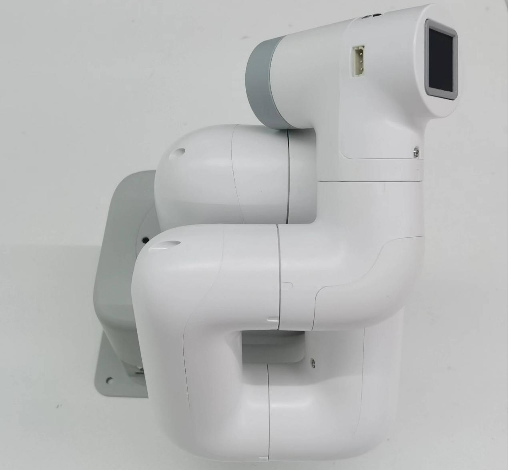
  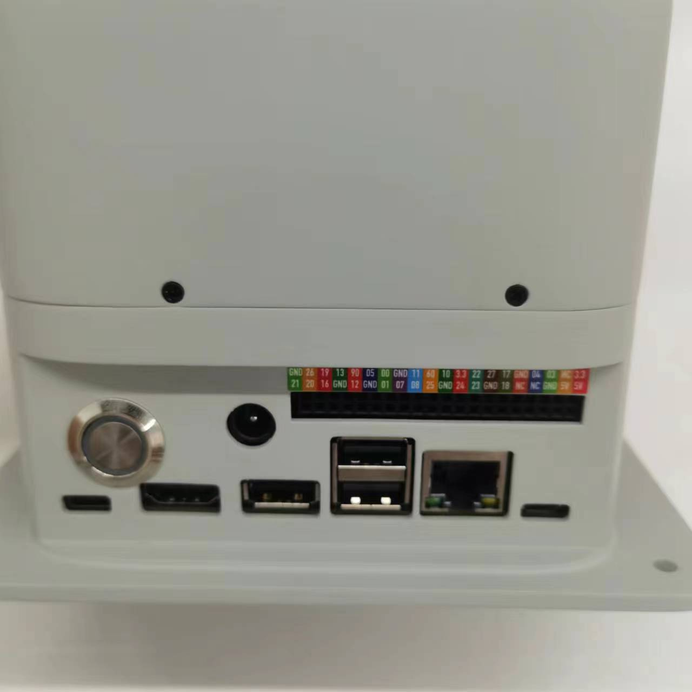
   Step 1: the cover is fitted; the TF-card slot is inside the base.

  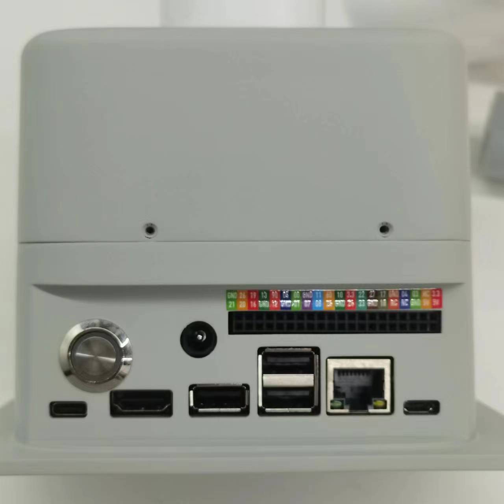
  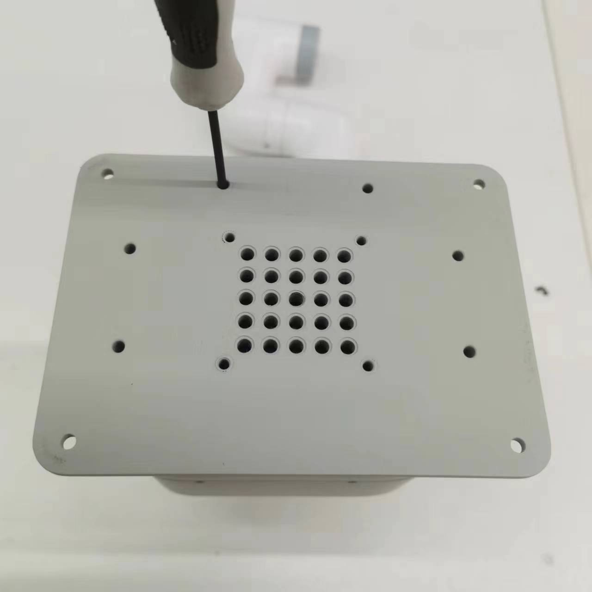
   Steps 2–3: two front screws, then six bottom screws.

  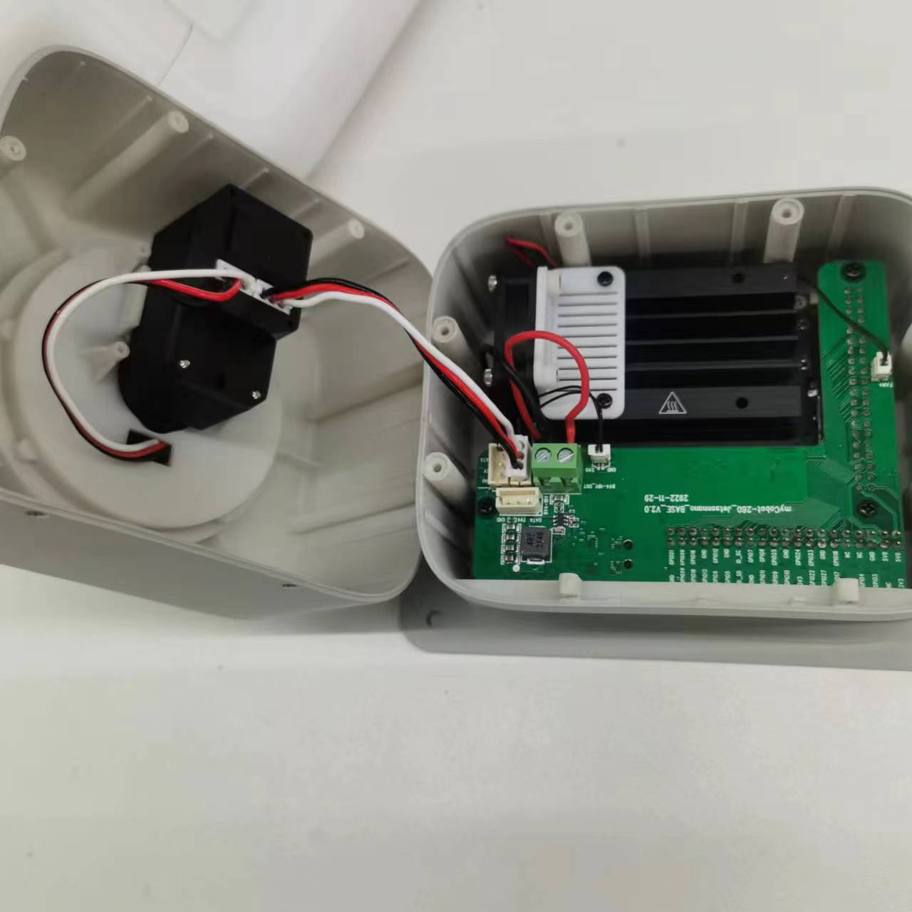
  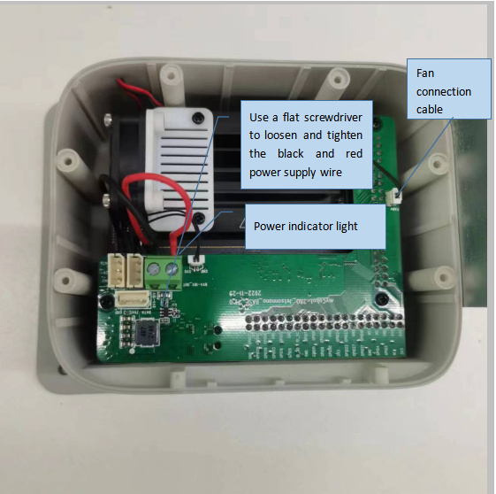
   Steps 4–5: unplug the servo cable, then the fan, power-indicator and power cables.

  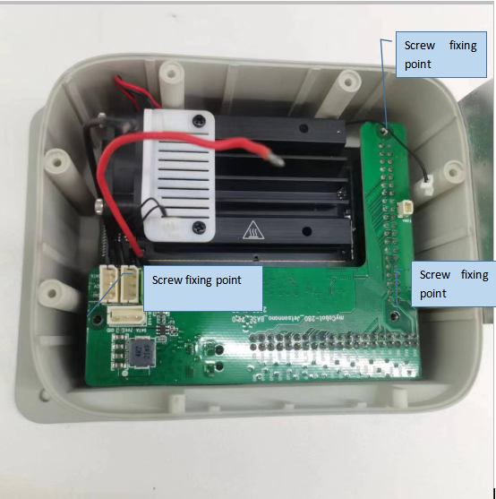
  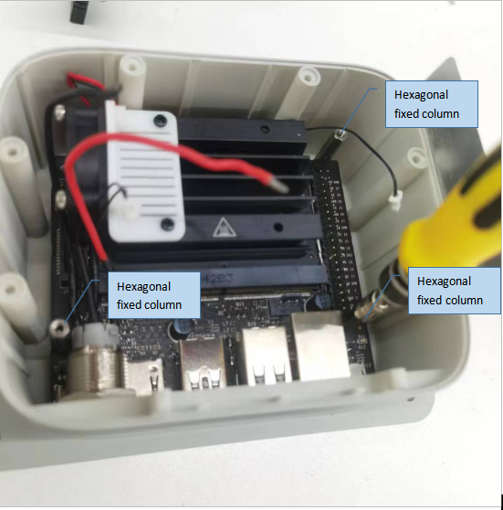
   Steps 6–7: remove the green PCBA and its three screws, then the three standoffs.

  
   Step 8: lift out the main control board (the Jetson Nano); anti-static precautions.

### 6.3 Replace the card

9. Remove the TF card from its slot and fit the replacement; observe anti-static precautions.
10. Reinstall the main control board (reverse of step 8).

  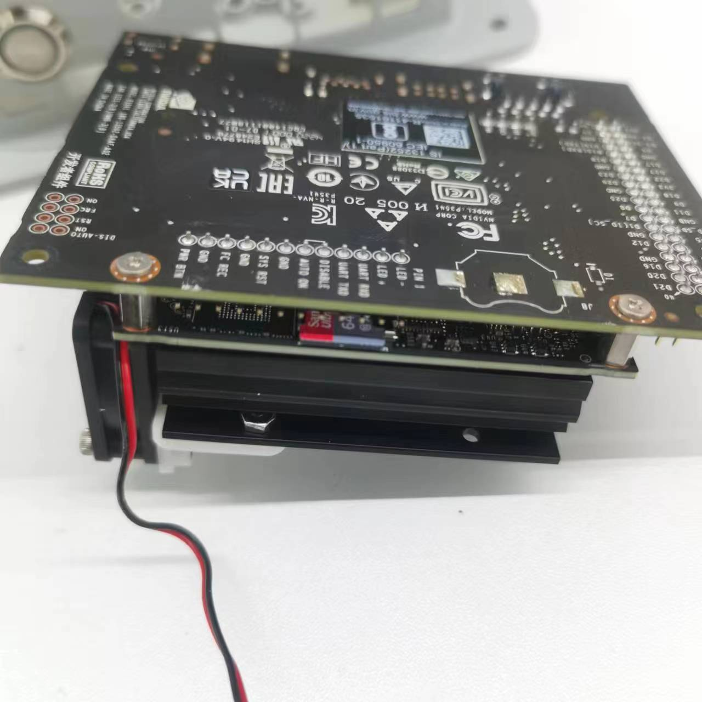
  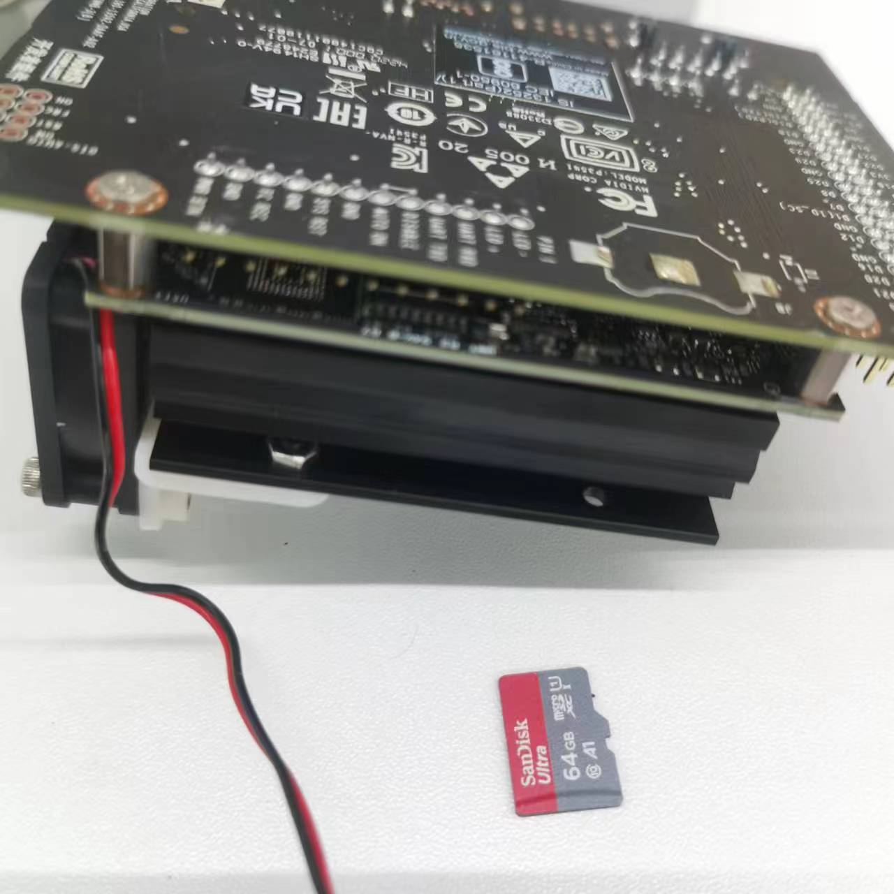
   Step 9: release and remove the TF card, then fit the replacement.

  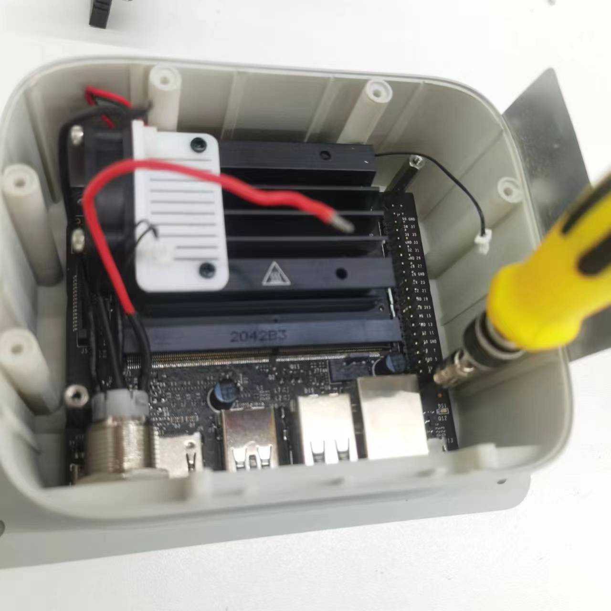
   Step 10: reinstall the main control board.

### 6.4 Close the base

- Reassemble in reverse order: standoffs, then the PCBA and its three screws, then the cables.
- Reconnect the servo, fan, power-indicator and power cables in their original positions.
- Refit the six bottom screws and the two front screws.
- Check that no cable is pinched before closing the cover.

  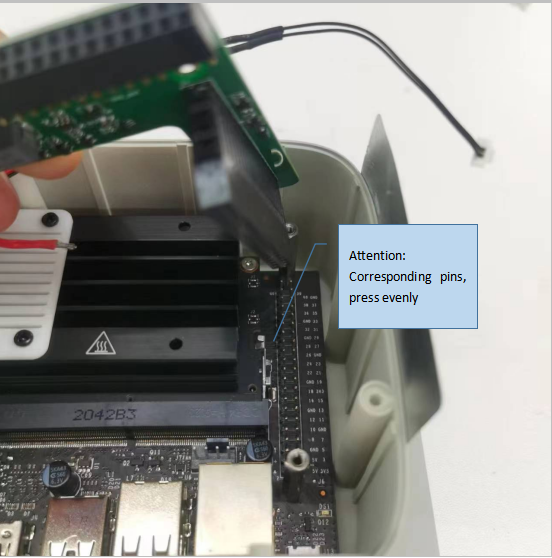
  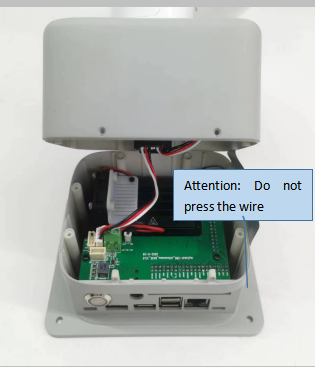
   Assembly: refit the standoffs and PCBA, then reconnect the cables.

  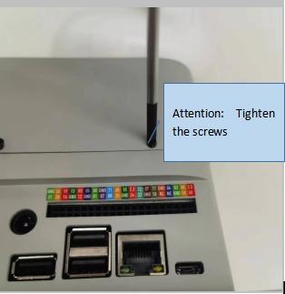
   Assembly: route the cables clear of the cover before closing it.

### 6.5 System image

The card must hold the official myCobot 280 JN image. The Ubuntu 20.04 images match the installed
system (Ubuntu 20.04.6, [03_jetson_nano.md](03_jetson_nano.md)).

| System | The guide assigns it to | Image |
| :--- | :--- | :--- |
| Ubuntu 18.04 | legacy units | [download](https://download-elephantrobotics.oss-cn-shenzhen.aliyuncs.com/Product_software/iMage-ISO/myCobot-280JetsonNano/myCobot_280_Jetsonnano_V221101-shrink.zip) |
| Ubuntu 20.04 (V20250326) | units bought **before** 2024-10-09 | [download](https://download.elephantrobotics.com/Product_software/iMage-ISO/myCobot-280JetsonNano/myCobot_280_ubuntu_V20250326_20.04JN_aarch64.zip) |
| Ubuntu 20.04 (V20241108) | units bought **after** 2024-10-09 | [download](https://download.elephantrobotics.com/Product_software/iMage-ISO/myCobot-280JetsonNano/myCobot_280_ubuntu_V20241108_20.04JN_aarch64.tar.gz) |

The guide's before/after assignment does not follow the version dates; confirm the correct image with
the vendor if the purchase date is unknown.

SHA-256 (Ubuntu 18.04): `2f1e40c1480b077bcc83abd3b79ac175f25d21e9cc344a014636167ee2eb087c`.

### 6.6 Write the image (Ubuntu)

Write the downloaded image to the new card from an Ubuntu host; this erases the card.

**Option A — GNOME Disks.**

1. Insert the card and open Disks.
2. Select the card in the device list.
3. Menu → **Restore Disk Image…**.
4. Select the `.img` and click **Start Restoring**.

**Option B — terminal (`dd`).**

1. Find the card device with `lsblk` (for example `/dev/sdb`; use the device, not a partition such as `/dev/sdb1`).
2. Unmount its partitions: `sudo umount /dev/sdb?*`.
3. Write the image: `sudo dd if=<image>.img of=/dev/sdb bs=4M status=progress conv=fsync`.
4. Flush and remove the card: `sync`.

Writing to the wrong device destroys its data; confirm the device with `lsblk` before writing.

---

<!-- nav:auto -->

  <a href="#top"><b>Top</b></a>

