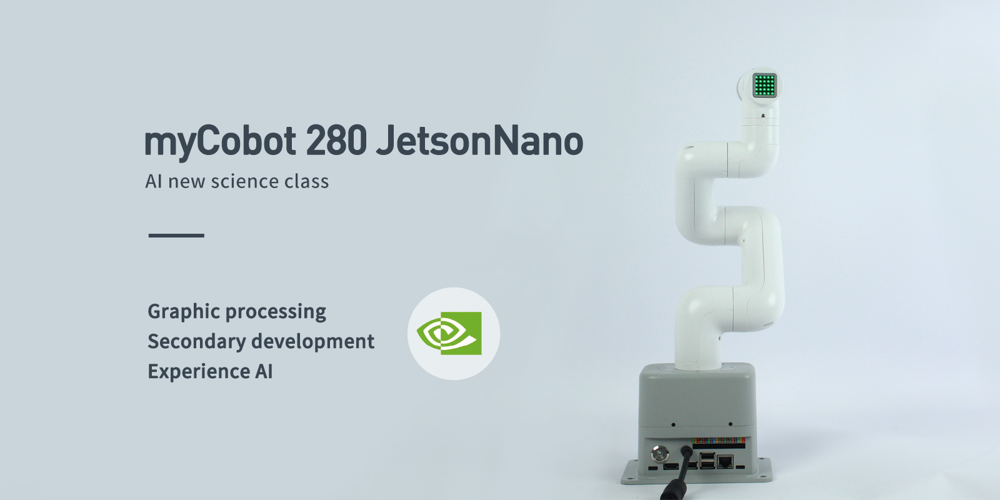

# 00 · Specifications — Hardware

<!-- nav:auto -->

  <a href="../../README.md"><b>Home</b></a> &nbsp;|&nbsp;
  <a href="../README.md"><b>&#8592; Back</b></a> &nbsp;|&nbsp;
  <a href="01_overview.md"><b>Forward &#8594;</b></a>

  
   A myCobot 280 for Jetson Nano with the adaptive gripper fitted.

---

## Facts

- **Arm:** myCobot 280 Jetson Nano (6 DOF). Reach 280 mm, payload ~250 g, repeatability ±0.5 mm, weight 1030 g.
- **Base computer:** NVIDIA Jetson Nano 4 GB (L4T R32.6.1 / JetPack 4.6.1, Ubuntu 20.04.6, kernel 4.9.253-tegra, CUDA 10.2, Python 3.8.10). Serial to arm: `/dev/ttyTHS1` @ 1,000,000 baud; user `er` in `dialout`.
- **Wrist computer:** M5Stack Atom ESP32 (`atomMain`), firmware reports `get_system_version = 73` (pymycobot 4.0.4b5, class `MyCobot280`).
- **Gripper:** Adaptive, 20–45 mm opening, ~150 g gripping force.
- **Camera:** `/dev/video0`, MJPG (preferred for higher framerate). Hand-eye calibration required for vision tasks.
- **I/O:** Base 40-pin header reads **right to left** (pin 1 far right), BCM numbering. UART2/I2C2 used internally. See [06_pinouts.md](06_pinouts.md).
- **No e-stop installed yet:** M1 designs and builds the e-stop (#27/#45/#52). See [09_buttons_and_e_stop.md](09_buttons_and_e_stop.md).
- **Joint limits (degrees):** J1 ±168, J2 ±140, J3 ±150, J4 ±150, J5 −155/+160, J6 ±180.
- **Power:** DC 8–12 V.
- Tools (gripper, camera) attach with LEGO pins.
- The Jetson uses an **Intel Wireless-AC card** (PCIe) and **Bluetooth 4.2**; the Ethernet port is present but not connected.
- Safety and maintenance: see [10_safety_and_handling.md](10_safety_and_handling.md) and [11_maintenance.md](11_maintenance.md).

---

## Notes

| # | Note | Contents |
| :---: | :--- | :--- |
| — | **[README.md](README.md)** | Quick facts, glossary, manual contradictions |
| 01 | **[01_overview.md](01_overview.md)** | Parts, ports, base interior, wrist |
| 02 | **[02_arm_parameters.md](02_arm_parameters.md)** | Sizes, joints, reach, geometry |
| 03 | **[03_jetson_nano.md](03_jetson_nano.md)** | The computer in the base |
| 04 | **[04_gripper.md](04_gripper.md)** | The adaptive gripper |
| 05 | **[05_camera.md](05_camera.md)** | The USB camera |
| 06 | **[06_pinouts.md](06_pinouts.md)** | Base 40-pin header and wrist ports |
| 07 | **[07_serial_protocol.md](07_serial_protocol.md)** | Serial frame format and encoding |
| 08 | **[08_command_reference.md](08_command_reference.md)** | All 62 opcodes |
| 09 | **[09_buttons_and_e_stop.md](09_buttons_and_e_stop.md)** | Stop-button options |
| 10 | **[10_safety_and_handling.md](10_safety_and_handling.md)** | Safety rules, transport, storage |
| 11 | **[11_maintenance.md](11_maintenance.md)** | Maintenance, TF-card replacement and calibration |

---

## Quick facts

| Item | Value |
| :--- | :--- |
| Product | Little Elephant Collaborative Robot Arm |
| Model | myCobot 280 for Jetson Nano |
| Joints (DoF) | 6 |
| Payload | 250 g |
| Working radius | 280 mm |
| Repeatability | ±0.5 mm |
| Weight | 1030 g |
| Power | DC 8–12 V (port rated 8.4–14 V), supplied 5 A adapter |
| Jetson power rails (measured) | 5008 / 5000 / 5000 mV on the three INA3221 inputs (≈5.0 V) |
| Operating temperature | −5 °C to +45 °C |
| Base computer | NVIDIA Jetson Nano 4 GB (L4T R32.6.1 / JetPack 4.6.1, Ubuntu 20.04.6, kernel 4.9.253-tegra, CUDA 10.2, Python 3.8.10) |
| Wrist computer | M5Stack Atom (ESP32, `atomMain`) |
| Gripper | Adaptive, 20–45 mm, 110 g (150 g gripping force) |
| Camera | myCobot camera v2.0, about 60° field of view, `/dev/video0`, MJPG preferred |
| Firmware (measured) | system version **73**, basic version **−1** (pymycobot 4.0.4b5, class `MyCobot280`) |
| Data link | Type-C (external, 115 200 baud), `/dev/ttyTHS1` (internal, 1 000 000 baud) |
| Storage temperature | −20 °C to +55 °C, ≤ 95 % humidity |
| 40-pin header | Reads **right to left** (pin 1 far right), BCM numbering |

---

## Glossary

| Term | Meaning |
| :--- | :--- |
| **DoF (degrees of freedom)** | Number of independent axes; 6 = an arm plus a wrist. |
| **Payload** | Maximum mass it can hold (~250 g). |
| **End-effector** | What is on the tip: gripper, camera, suction pump, pen. |
| **Repeatability** | How tightly it returns to a taught point (±0.5 mm). |
| **Joint / servo** | One motor that turns one part of the arm. |
| **Servo bus** | The shared serial cable the six motors and the Atom listen on. |
| **UART** | A two-wire serial port (TX/RX). The Jetson's is `/dev/ttyTHS1`. |
| **GPIO** | A general-purpose pin: input for a button, output for an LED. |
| **BCM numbering** | The Raspberry-Pi-style pin naming used on the base sticker. |
| **DH / SDH** | A table of numbers describing the arm's geometry to maths software (Standard Denavit–Hartenberg). |
| **Baud** | Serial speed in bits/second — 115 200 (USB) or 1 000 000 (internal). |
| **Calibration / zero point** | Each joint's physical home position (see [11](11_maintenance.md)). |
| **Refresh mode** | The arm is re-commanded continuously (see [08](08_command_reference.md)). |

---

## Manual contradictions

The official pages disagree in these places.

1. **SoC name.** The parameter table says *Broadcom BCM2711*; the board reports `nvidia,tegra210`
   (NVIDIA Tegra X1, T210) under "NVIDIA Jetson Nano Developer Kit".
2. **RAM / clock.** The parameter table says 2 GB at 1.43 GHz; the unit reports 4 GB and a 1479 MHz
   maximum.
3. **Adapter voltage.** The product page lists 8.4 V; the firmware page lists 12 V. Both 5 A. The port
   is rated 8.4–14 V. The Jetson's three power-monitor inputs read 5008 / 5000 / 5000 mV (≈5.0 V) on
   the unit.
4. **"Electric".** For the gripper, "electric" is the motor type; the drive is gear + connecting rod.
5. **Geometry.** The DH drawing and the published SDH table differ slightly; the SDH table is the kinematic model, 
   the drawing is CAD. Both are in [02_arm_parameters.md](02_arm_parameters.md).
6. **Network card.** The firmware page states the Jetson has no network card and connects only through
   the Ethernet port; the unit carries an Intel Wireless-AC card (PCIe) and Bluetooth 4.2 and is
   online over Wi-Fi.

  

<!-- nav:auto -->

  <a href="#top"><b>Top</b></a>

