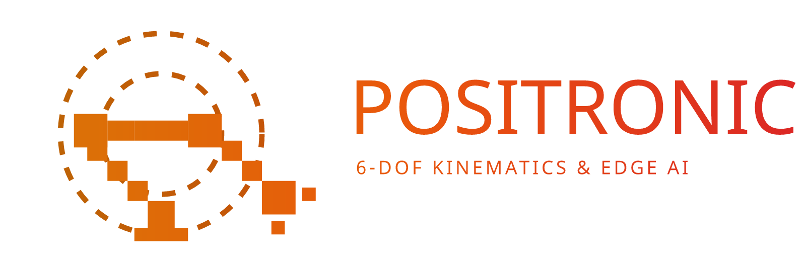

  

# Assets — Software

<!-- nav:auto -->

  <a href="../../README.md"><b>Home</b></a> &nbsp;|&nbsp;
  <a href="../logos/README.md"><b>&#8592; Back</b></a> &nbsp;|&nbsp;
  <a href="../diagrams/README.md"><b>Forward &#8594;</b></a>

Screenshots and diagrams for the software stack. Used mainly by
[`../../00_specs/software/`](../../00_specs/software/README.md).

## Diagrams

| File | Shows |
| :--- | :--- |
| `ros2_control_overview.png` | `ros2_control`: controller_manager, controllers, hardware interfaces. |
| `urdf_link_layout.png` | A URDF: links joined by joints, each with an origin and axis. |
| `dh_diagram.jpg` | DH frame diagram for the myCobot. |
| `sdh_table.png` | The published SDH parameter table. |
| `workspace.png` | The 280 mm workspace sphere. |
| `gazebo_docs.png` | The Gazebo graphical interface. |

## Arm-manual screenshots (`manual_*`)

| File | Shows |
| :--- | :--- |
| `manual_ros2_install.png` | ROS 2 software layers (from the manual). |
| `manual_ros2_build.jpg` | A terminal running the ROS 2 environment on the arm. |
| `manual_ros2_shell.jpg` | The arm desktop with the ROS 2 Shell icon. |
| `manual_moveit_arch.png` | The MoveIt architecture (`move_group` and its interfaces). |
| `manual_moveit_run.png` | MoveIt running in RViz with the Move Group panel. |
| `manual_moveit_plan.gif` | MoveIt planning and executing a motion. |
| `manual_rviz1.png` | RViz (ROS 1) interface. |
| `manual_rviz2.png` | RViz2 interface with the myCobot model. |
| `manual_rviz2_open.png` | The myCobot RobotModel loaded in RViz2. |
| `manual_rviz2_gui.png` | The myCobot ROS GUI in RViz. |
| `manual_rviz2_camera.png` | The camera feed shown in RViz. |
| `manual_rviz2_keyboard.png` | Keyboard teleoperation in RViz. |
| `manual_mystudio.jpg` | The myStudio application with the arm connected. |
| `manual_pymycobot.jpg` | The pymycobot project page. |
| `manual_atom_pc.jpg` | The Atom connected to a PC. |
| `manual_interpreter.jpg` | The Python interpreter on the arm. |
| `manual_vnc.png` | A VNC session to the arm. |
| `manual_ssh.png` | SSH access to the arm. |
| `manual_ssh_2.png` | SSH access, second view. |
| `manual_system.png` | The arm's system/desktop view. |

<!-- nav:auto -->

  <a href="#top"><b>Top</b></a>

